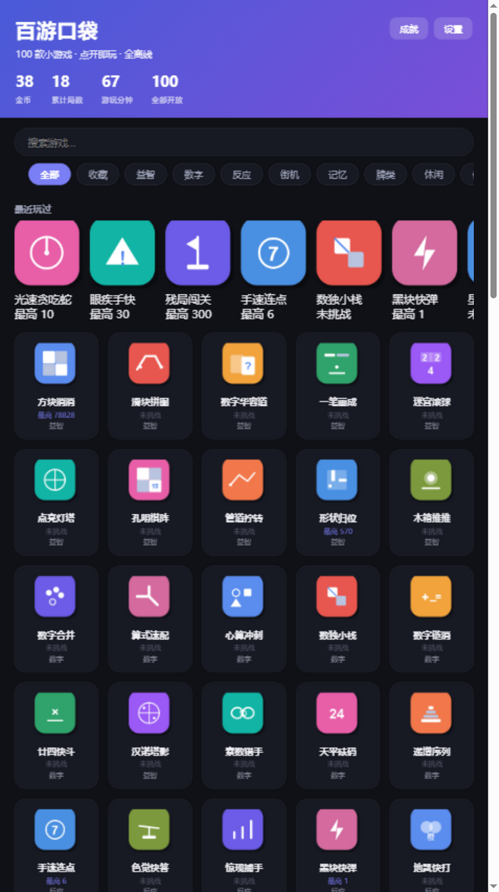
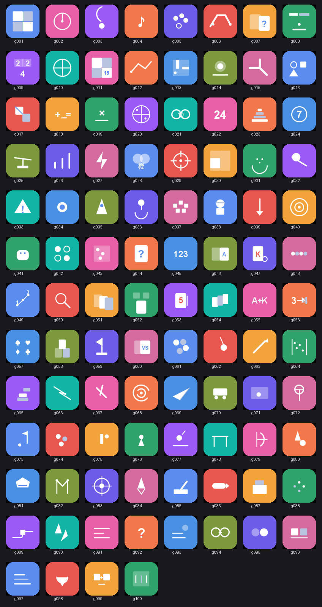
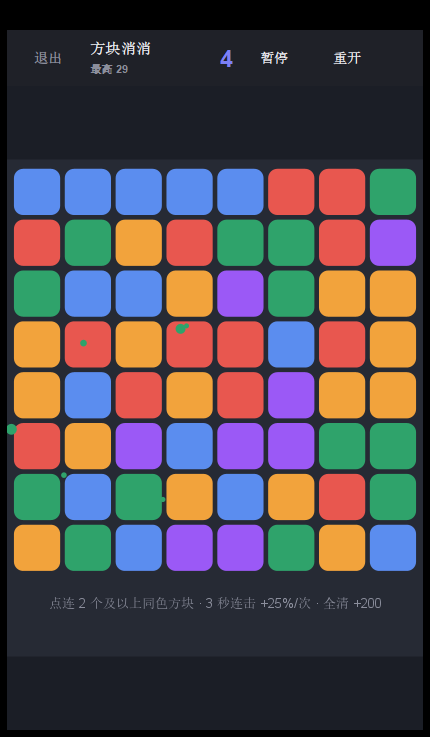
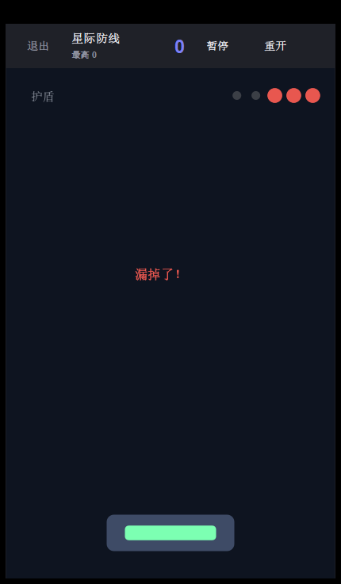

# 百游口袋 · 100 款小游戏合集（Android + PC + 浏览器 三端）

单一代码库、三个平台：**Android APK**（手机/平板）+ **PC 桌面版**（Swing 窗口）+
**网页版**（浏览器实时画面，局域网内手机也能开）。**100 款游戏全部开放可玩**
（10 分类 × 10 款），支持分类筛选、搜索、收藏、最近玩过；统一管理金币、成就、
最高分与游玩时长；**零权限、完全离线、数据只存本机**。

- 当前版本 **v1.0**（versionCode 10，含玩法介绍系统 + 玩家视角 QA 修复）：**100 款全部实现**
- Android 产物：`dist/baiyou-pocket-v1.0.apk`（约 0.2 MB）
- PC 产物：`dist/baiyou-pocket-desktop-v1.0.jar`（约 0.5 MB，含桌面窗口 + 网页服务）
- 100 款游戏清单：见 [GAMELIST.md](GAMELIST.md)（由脚本从代码自动生成）
- 后续扩展规范：见 [EXTENSION.md](EXTENSION.md)
- 真实渲染截图：见 [screenshots/](screenshots/)（网页首页 / 100 个程序化图标 / 游戏实帧）

|  |  |
| --- | --- |
| 网页版首页（渐变 Hero + 分类筛选 + 最近玩过） | 100 个 Canvas 程序化专属图标，零图片资源 |

|  |  |
| --- | --- |
| 方块消消（连击/下落动画） | 星际防线（真实渲染帧） |

## 已开放的 100 款游戏（v1.0 全量）

10 分类 × 10 款，完整清单见 [GAMELIST.md](GAMELIST.md)。实现方式分两类：

**家族基类（8 个共享基类驱动 1/3 的游戏）**——`game/` 目录：
`QuizGame`（题库问答×9：成语/字谜/诗词/词链/找茬/算式/心算/谜语/部首）、
`PopTargetGame`（目标点杀×6：惊现捕手/地鼠/神枪/火箭/防线/素数）、
`MemoryDuelGame`（翻牌人机对战×3）、`DodgeGame`（躲避×4：红区/星屑/坠落/滑雪）、
`ArcShotGame`（抛射瞄准×3：投篮/射箭/弹弓）、`RunnerGame`（横版跑酷×2）、
`SeqMemoryGame`（序列记忆×2）、`CardKit`（纸牌绘制工具）。

**独立实现（玩法独特的 60+ 款）**，每款一个类（100~260 行）：
消除/2048/滑块拼图/华容道/一笔画/迷宫/点灯/孔明棋/管道/推箱子/数独/24点/汉诺塔/
泡泡射击/切绳/弹珠台/堆塔/解绳/挖矿/转盘迷宫/纸飞机/挪车/点球/高尔夫/桌球/乒乓/
羽毛球/保龄球/贪吃蛇/弹球/打字弹幕/激光折角/磁暴连锁/拼字/排序句/找词 等。

所有游戏：Canvas 程序化美术（零图片资源）、合成音效、统一结算（金币/最高分/成就）、
支持暂停/重开/退出，Android 与 PC/网页共用同一份玩法代码。

## 双端三壳：一套游戏代码，三个平台

```
                    ┌──────────── 共享核心（纯 Java，三端复用）────────────┐
                    │ Registry（100款）/ Store（数据）/ Achievements      │
                    │ ResultMerger（结算合并）/ CrashGuard                │
                    │ Game + CanvasGame（游戏基类 + 特效系统：浮字/粒子/震屏）│
                    │ + 100 款游戏 + IconDrawable                          │
                    └────────────────────────────────────────────────────┘
                      ↑ android.jar          ↑ Android API 垫片 + Swing/HTTP
┌──────── Android 壳 ────────┐  ┌────────── PC 壳（Swing）──────────┐  ┌──────── 网页壳 ────────┐
│ MainActivity（首页）        │  │ HomeFrame（首页）/ GameHostFrame   │  │ WebServer（--web 8080） │
│ GameHostActivity(:game进程) │  │ ViewHostPanel（游戏窗口）          │  │ 首页 HTML + MJPEG 实时流 │
│ 系统真实现 Canvas/Handler   │  │ Handler=javax.swing.Timer（EDT）   │  │ /input 回传触摸事件      │
└────────────────────────────┘  └───────────────────────────────────┘  └────────────────────────┘
```

- **PC 端不是移植，是同一份代码**：游戏类、数据、成就、结算公式 100% 复用；
  平台差异收敛在 `desktop/shim-src/` 的 13 个 Android API 垫片里
  （Canvas→Graphics2D、Handler→javax.swing.Timer（保持 EDT 单线程模型，免锁）、
  View→宿主面板驱动、org.json→maven.aliyun 下载的同名实现，已并入 fat jar）。
- **网页版是第三块屏，不是重写**：`java -jar …jar --web 8080` 启动本地 HTTP 服务
  （JDK 自带 httpserver，零依赖），游戏跑在单条"游戏线程"上（Handler 网页驱动），
  画面以 MJPEG 实时流推给浏览器 ``，网页上的鼠标/触摸经 `/input` 回传为
  触摸事件——浏览器只是另一个远程显示+输入壳。结算/金币/成就与 PC 端共用
  `desktop-data/` 存档。服务绑定 0.0.0.0：**同一局域网的手机浏览器输入
  `http://<电脑IP>:8080` 也能玩**。
- **PC 游戏窗口与手机同构**：HUD（退出/最高分/实时分数/暂停/重开）、暂停遮罩、
  结算弹窗（再来一局/退出）、金币与成就回传合并，公式三端完全一致。
- **实时画面**：PC 端直接打开窗口游玩；网页版开箱即玩；另有演示模式
  `java -jar dist/baiyou-pocket-desktop-v1.0.jar --demo`——抽样自动游玩 12 款、
  注入触摸、截图存 `desktop/screenshots/`（含结算数据回传，全流程真实跑通）。

## Android 端架构要点

**崩溃隔离（三层防线）**

1. 进程隔离：游戏统一跑在 `:game` 进程（Manifest 声明），任何游戏崩溃（含 OOM、
   native 崩溃）只结束该进程，主界面与其它游戏不受影响；
2. 运行时兜底：`SafeFrame.dispatchTouchEvent` 捕获全部触摸异常，
   `CanvasGame` 逻辑帧循环（`Game.runSafe`）捕获逻辑异常 → 记日志 + 安全退出；
3. 崩溃落盘：`CrashGuard` 把未捕获异常写入 `files/logs/crash-*.log`，便于回归修复。
   最高分在游玩中实时写 `scores/<id>.json`（原子写），进程被杀成绩也不丢。

**统一本地数据（多进程分工，杜绝并发写坏文件）**

| 文件 | 写入方 | 内容 |
| --- | --- | --- |
| `store.json` | 仅主进程/PC 主窗口 | 金币、成就、收藏、最近玩过、设置、累计时长/局数 |
| `scores/<id>.json` | 仅游戏进程/PC 游戏窗口 | 单游戏最高分（实时）、局数、上次游玩 |

金币规则：每局 `min(50, 得分/10)`；半局退出或崩溃也按当前分结算。
成就 8 枚：局数、游玩广度、单局 500 分、100 金币、首次收藏等。

**UI 适配**

- 深色模式：颜色全部走主题 attr（Android）/ `Theme` 单例（PC），
  日/夜两套色值完全一致，Android 跟随系统、PC 一键切换；
- 手机/平板：首页网格列数按屏幕宽度自适应（2~5 列），游戏画面基于
  固定逻辑坐标系等比缩放居中，任何尺寸不留变形。

**合规（原创素材）**

- 游戏名全部为原创中文命名（见 GAMELIST.md，不含任何现有商业游戏商标）；
- 美术零图片资源：图标、游戏内图形全部 Canvas/Drawable 程序化绘制；
- 音效：Android 用 `ToneGenerator` 合成音，PC 用 `Beep`（正弦波合成），无音频文件；
- 玩法为通用公有玩法，不涉及代码或素材抄袭。

## 目录结构

```
baiyou-pocket/
├── android/                        # Android 壳 + 共享核心
│   ├── AndroidManifest.xml         # versionCode/versionName 需与 build_apk.py 同步
│   ├── build_apk.py                # 免 Gradle APK 流水线
│   ├── res/                        # values / values-night 主题、五档启动图标
│   └── src/com/baiyou/pocket/
│       ├── App / CrashGuard        # 进程无关入口 + 崩溃落盘（共享）
│       ├── MainActivity            # Android 首页（程序化布局）
│       ├── GameHostActivity        # 游戏宿主（独立进程，HUD/结算/兜底）
│       ├── data/                   # Registry / Store / Achievements / ResultMerger（共享）
│       ├── game/                   # Game / CanvasGame（共享）
│       ├── games/…Game ×100        # 100 款游戏实现（共享）
│       └── ui/IconDrawable         # 100 个程序化图标（共享）
├── desktop/                        # PC + 网页 端
│   ├── shim-src/android/…          # 13 个 Android API 垫片（仅非 Android 编译）
│   ├── src/…/desktop/              # Swing 壳 + WebServer 网页壳 + 演示模式
│   ├── libs/json-20240303.jar      # org.json（maven.aliyun 下载，打入 fat jar）
│   ├── build_desktop.py            # PC/网页 端构建脚本
│   └── screenshots/                # 演示模式自动生成的真实渲染截图
├── tools/                          # 构建/QA 辅助脚本
│   ├── make_icon.py                # 启动图标生成（纯标准库）
│   ├── gen_gamelist.py             # 从 Registry 生成 GAMELIST.md
│   ├── qa_play.py / selftest_web.py / scan_create.py   # 全量自测：逐款自动游玩/随机压测/实例化扫描
│   └── make_zip.py                 # 发布压缩包打包
├── screenshots/                    # 仓库展示截图（网页首页/图标总览/游戏实帧）
├── dist/                           # 构建产物（git 忽略；成品见 GitHub Release 附件）
├── 百游口袋-PC.bat / 百游口袋-网页.bat   # 一键启动
├── GAMELIST.md                     # 100 款清单（自动生成）
├── EXTENSION.md                    # 扩展开发规范（含垫片 API 白名单与自测口径）
└── LICENSE                         # MIT
```

## 构建与运行

环境依赖：JDK 11+、Python 3。**PC/网页端开箱即建**（JDK + 仓库内
`desktop/libs/json-20240303.jar` 即可）；**Android 端工具链不随仓库分发**，
需要自行准备并放到 `../biancheng-app/_build/`（或修改 `android/build_apk.py`
顶部的 `BUILD` 常量指向任意位置）：

| 需要的文件 | 来源 |
| --- | --- |
| `android-14/aapt2.exe`、`d8`、`zipalign.exe`、`lib/apksigner.jar` | 腾讯镜像 build-tools 34 zip（`https://mirrors.cloud.tencent.com/AndroidSDK/` 下 build-tools_r34 相关 zip，解压取目录） |
| `android-34/android.jar` | 腾讯镜像 platform 34 zip（同站 platform-34 相关 zip） |
| 新版 R8（build-tools 34 自带 d8 在新 JDK 上会 NPE） | 阿里云 maven `https://maven.aliyun.com/repository/google` 搜 `r8` |

> 目录列表页可能返回 Nexus 400，但**具体文件路径可直接下载**；海外网络环境直接用
> dl.google.com 的官方包同名解压即可。

```bash
# Android APK（约 10 秒）
python android/build_apk.py
adb install -r dist/baiyou-pocket-v1.0.apk

# PC 桌面版（约 5 秒）
python desktop/build_desktop.py
java -jar dist/baiyou-pocket-desktop-v1.0.jar     # 或双击 百游口袋-PC.bat

# 网页版（同一 jar，浏览器实时画面）
java -jar dist/baiyou-pocket-desktop-v1.0.jar --web 8080   # 或双击 百游口袋-网页.bat
# 浏览器打开 http://127.0.0.1:8080 （局域网手机访问 http://<电脑IP>:8080）

# PC 演示模式（抽样自动游玩 12 款 + 截图到 desktop/screenshots/）
java -jar dist/baiyou-pocket-desktop-v1.0.jar --demo

# 校验
aapt2 dump badging dist/baiyou-pocket-v1.0.apk
apksigner verify --print-certs dist/baiyou-pocket-v1.0.apk
```

版本号规则：改版本时 **Manifest 的 `android:versionCode/versionName`、
`android/build_apk.py` 与 `desktop/build_desktop.py` 三处必须同步**
（APK 脚本内置一致性检查；aapt2 的版本旗标不会覆盖 Manifest 属性）。

## 后续路线图

1. 真机回归（APK 首装全流程）+ 每款游戏的首局教学提示；
2. 成就扩容（每游戏专属成就）+ 金币消耗玩法（主题皮肤）；
3. 游戏横竖屏适配、手柄/键盘支持；
4. PC 端打包 exe（jpackage）与 Android 端正式签名发布。

## 已知边界（v1.0）

- APK 使用 debug 签名（与棋类合集共用同一 debug.keystore）；上架前需换正式签名；
- Android 端未做真机/模拟器实机验证（本机无模拟器），已通过 badging/签名/清单
  静态校验；**PC 端通过演示模式实跑验证，网页端通过浏览器自动化实跑验证**；
- 100 款游戏均为"小游戏"体量（单局 1~3 分钟），部分牌类（经典接龙/空当接龙）
  做了规则精简；平衡性以"可玩、不劝退"为准，后续可按数据微调；
- 成就阈值（单局 500 分等）以 v0.1 的 5 款原型调参，部分游戏达成难度有差异。

## License

[MIT](LICENSE) © 2026 cjy-kenny。玩法为通用公有玩法；游戏名、美术（Canvas 程序化绘制）、
音效（合成音）均为原创，不含任何现有商业游戏的商标、代码或素材。
